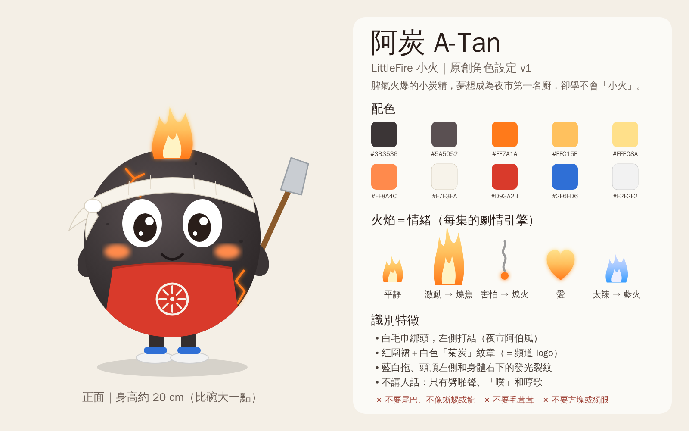

# LittleFire 小火：經營策略

## 一句話定位

一塊脾氣火爆的小木炭「阿炭」在台灣夜市學做小吃。沒有對白，每支 20–30 秒，全世界都看得懂。



## 為什麼這樣做

| 決定 | 原因 |
|---|---|
| **原創角色，不用小火龍** | 角色的版權是你的，YPP、LINE 貼圖、周邊、業配都能做。寶可夢角色隨時可能被任天堂發版權警告。2026 年 5 月，做寶可夢動畫短片的「PokéNational Geographic」就因此被刪頻道。 |
| **沒有對白** | 不用配音也不用翻譯，海外觀眾一樣看得懂，Shorts 能推到的人更多。 |
| **台灣小吃** | 有辨識度、題材用不完，海外觀眾也好奇。 |
| **火焰＝情緒** | 阿炭本身就是火源，他一激動鍋子就燒焦，一害怕火就熄，睡著反而是完美的小火。每集的笑點從這裡長出來，不需要套模板。 |
| **頻道名「小火」** | 剛好是阿炭永遠學不會的事，第 1 集〈小火慢滷的滷肉飯〉就在講這個。 |

## 第 0 週：頻道改造（這些要你親自做）

1. **舊的小火龍影片設成「私人」或刪除**。只要還公開，就可能被版權警告。
2. **改 handle**：@Mander_kun 是從 Charmander 來的。到 YouTube Studio → 自訂 → 基本資訊，從下面挑一個還沒被用掉的：`@LittleFireATan`、`@LittleFireTW`、`@atan.littlefire`
3. **頻道說明**（直接貼上）：
   ```
   一塊脾氣火爆的小木炭「阿炭」，夢想成為夜市第一名廚，卻怎麼樣都學不會「小火」。
   每週二、四、六 18:00 更新台灣小吃短片 🔥

   A-Tan is a hot-tempered little lump of charcoal who dreams of becoming the best cook in the Taiwanese night market, if only he could learn to cook on low heat.
   New shorts every Tue / Thu / Sat.
   ```
4. **頭像**：直接上傳 [`avatar.png`](avatar.png)（800×800，向量原檔 `avatar.svg`，縮到 24px 還認得出來）。想要 3D 質感的版本，再用下面的 prompt 加上定裝照生成：
   ```
   Close-up portrait of A-Tan (use the reference sheet), centered face with the small flame on top and the white towel headband, friendly smile, on a solid warm red background (#D93A2B), high contrast, simple, readable at very small size, no text
   ```
5. **橫幅**（2560×1440，重要內容放在中間 1546×423 的安全區）：
   ```
   Wide banner, a Taiwanese night market street at dusk with warm lights and steam, A-Tan standing on a food stall counter on the right holding a spatula, clean empty space in the center for the channel name, stylized 3D animation look, no text
   ```
6. **Google 帳號開兩步驟驗證**。這是 YPP 的必要條件，越早開越好。
7. **驗證電話**：Studio → 設定 → 頻道 → 功能資格。驗證後才能自訂縮圖、上傳超過 15 分鐘的影片（合集會用到）。
8. **建立播放清單**「阿炭的小火廚房」。

## 發片節奏

- **每週 3 支 Shorts**：二、四、六 18:00（台灣時間）。開始發之前先做好 **3 支庫存**，之後一直保持至少 2 支庫存。
- **每 10 支剪一支合集長片**（16:9，約 4–5 分鐘），補長影片的觀看時數：
  `python -m yt_auto compile ep01 ep02 ep03 ep04 ep05 ep06 ep07 ep08 ep09 ep10 --name vol1`
- **每支的製作時間**：5–6 個鏡頭，每個鏡頭抽 2–4 次，大約 1–1.5 小時。剪輯和上傳清單由程式產生，約 5 分鐘。

## 收益路線圖

說實話：大部分頻道到不了 YPP，Shorts 每千次觀看的收益也不高。所以要同時經營 YPP 以外的收入。

| 階段 | 門檻 | 可以賺什麼 |
|---|---|---|
| 0–3 個月 | 先發 30–40 支，找出觀眾最買單的題材和笑點 | 還沒有 |
| 粉絲贊助層 | 500 訂閱 ＋ 90 天內 3 支公開影片 ＋ 90 天 300 萬次 Shorts 觀看（或 12 個月 3,000 小時長片） | 頻道會員、Super Thanks |
| 廣告分潤 | 2027/2/1 起的新申請者：1,000 訂閱 ＋ 90 天 2,000 萬次 Shorts 觀看（或 12 個月 8,000 小時長片） | 廣告分潤 |

**YPP 以外**（原創角色才做得到）：

- **LINE 貼圖**：阿炭的每種情緒（暴衝、熄火、愛心火、藍火、冒煙）本來就是貼圖。累積到 20–30 集、角色有點辨識度後就上架 LINE Creators Market。分潤比例以 LINE 官方條款為準（第三方估算創作者實拿約售價的 35%）。
- **業配**：台灣小吃、調味料、夜市、觀光相關品牌。通常要先有穩定的觀看數。
- **周邊**：貼紙、鑰匙圈。等有一群固定粉絲再做。

## 「不真實內容」自我檢查

YouTube 不禁止 AI，但「大量產出、每支都差不多」的頻道整個不能營利。每次寫新的一集都對一下這張表：

| 集 | 菜 | 出包方式 | 結局 | 結構 |
|---|---|---|---|---|
| 01 | 滷肉飯 | 急躁 → 滾到噴出來 | 睡著反而成功 | 順敘 |
| 02 | 鹽酥雞 | 被嚇到 → 油鍋起火 | 意外更好吃、變新菜單 | 倒敘 |
| 03 | 黑糖珍奶 | 沒耐心 → 一顆巨大珍珠 | 用更荒謬的方法解決 | 倒敘 |
| 04 | 蔥抓餅 | 太用力 → 爆開 | 碎片剛好落進袋子 | 順敘＋慢動作 |
| 05 | 地瓜球 | 好勝 → 膨到飛起來 | 被帶上天，開放式結尾 | 倒敘 |
| 06 | 胡椒餅 | 炭火不夠 → 自己跳進去 | 全身芝麻、被燙到 | 順敘（ASMR 開場） |
| 07 | 蚵仔煎 | 緊張 → 翻到天花板 | 驚險接住 | 倒敘 |
| 08 | 臭豆腐 | 被臭到 → 火熄滅 | 從害怕變成愛上 | 倒敘 |
| 09 | 薑母鴨 | 偷吃老薑 → 火變藍 | 藍色火焰秀、暖心收尾 | 順敘（季節集） |
| 10 | 烤玉米 | 太興奮 → 爆成爆米花 | 重來一次又爆（可循環） | 順敘 |

規則：

- 同一種出包方式或結局，不要連續用超過 2 集。
- 倒敘和順敘輪流用，不要每集都是「（稍早）…」。
- 每集的劇本是你決定的，留在 `episodes/` 裡，這就是「人的創作」的紀錄。
- 一天最多發 1 支，不要一次大量上傳。
- 標題、標籤、說明欄絕對不放寶可夢或其他 IP 的名字（程式會擋）。

## 每支 Shorts 的品質檢查

- 第 1 秒就要有動作，不要從空鏡頭開始。
- 每個鏡頭只做一件事。AI 影片在 5 秒內做兩件事很容易崩。
- 阿炭的造型有沒有跑掉？毛巾、紅圍裙、藍白拖、頭頂火苗。跑掉就重新生成。
- 畫面裡不要有 AI 生成的文字（通常是亂碼），字幕交給程式燒進去。
- 音效比配樂重要：劈啪、滋滋、「噗」就是阿炭的聲音。
- 結尾能接回開頭更好，循環播放會增加觀看次數。
- 配樂只用 YouTube 音效庫或有授權的音樂。

## 每週檢討（每週一）

1. `python -m yt_auto stats`，週報存在 `reports/`。
2. 到 YouTube Studio 看兩個數字：**觀看 vs. 滑走**（越高越好）和**平均觀看百分比**（Shorts 超過 100% 代表有人重看）。
3. 表現最好的 3 支有什麼共同點？下一批多做；表現最差的元素直接砍掉。

## 下一批題材（EP11–20）

| 集 | 題材 | 點子 | 建議發布 |
|---|---|---|---|
| 11 | 鍋貼 | 加水蓋鍋蓋，蒸氣把阿炭蒸成「白炭」 | 11 月 |
| 12 | 雞排 | 比臉還大的雞排，翻面時整片蓋在他身上像棉被 | 11 月 |
| 13 | 大腸包小腸 | 香腸太長塞不進糯米腸，越塞越歪 | 11 月 |
| 14 | 麻油雞 | 麻油爆香太香，香到他把自己也「爆香」了 | 12 月 |
| 15 | 冬至湯圓 | 手太燙，湯圓還沒下鍋就在手上煮熟了 | 12/22（冬至）前 |
| 16 | 烤地瓜 | 太冷了，躲進烤地瓜的鐵桶裡取暖 | 12 月 |
| 17 | 跨年特輯 | 跨年夜被大家當成煙火 | 12/31 |
| 18 | 刈包 | 「虎咬豬」，刈包反咬他一口 | 1 月（尾牙） |
| 19 | 發粿 | 要「發」才會好運，他吹太用力，粿裂成一朵花 | 2/5（除夕）前 |
| 20 | 元宵／天燈 | 變成天燈的火，跟第 5 集一樣飄上天（回扣梗） | 2/20（元宵）前 |

之後可以加第二個角色：**冰冰**，隔壁剉冰攤的冰塊，阿炭的死對頭。火 vs. 冰，夏天的題材（芒果冰、剉冰、愛玉）就有了。
